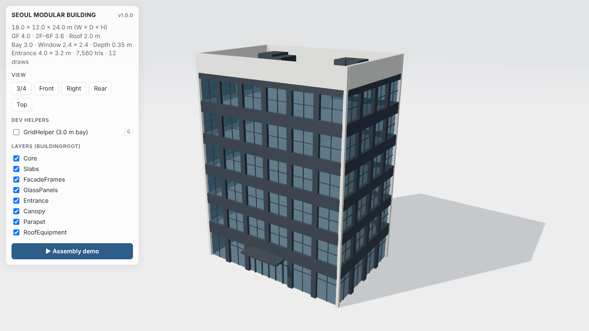

# SEOUL MODULAR BUILDING — Three.js 절차적 3D 모델

`v1.0.0` · Vite 8 + TypeScript + three.js r186 · 외부 3D 모델 없이 `BoxGeometry` 하나로 전체 건물을 절차적으로 생성합니다.



조립 데모 영상: [`docs/media/seoul-modular-building-demo.mp4`](docs/media/seoul-modular-building-demo.mp4) (17초, 1280×720)

## 실행 방법

필요 환경: Node.js `20.19+` 또는 `22.12+`, WebGL2 지원 브라우저.

```bash
cd seoul-modular-building
npm install
npm run dev        # http://localhost:5173 개발 서버
```

```bash
npm run build      # tsc 타입 검사 + 프로덕션 빌드 (dist/)
npm run preview    # 빌드 결과 확인 (http://localhost:4173)
npm test           # 치수/모듈/겹침 검증 단위 테스트 (vitest)
```

조작: 마우스 드래그 회전 · 우클릭 드래그 이동 · 휠 줌 · `G` 키 = GridHelper 토글.
패널에서 뷰 프리셋(3/4 · Front · Right · Rear · Top), 레이어(그룹)별 표시, 조립 데모 재생이 가능합니다.

URL 옵션: `?log=debug` (단계별 상세 로그) · `?grid=0|1` · `?capture=1` (영상 캡처용 화면).

## 프로젝트 구조

```
seoul-modular-building/
├── index.html
├── package.json / package-lock.json
├── tsconfig.json · vite.config.ts · vitest.config.ts
├── src/
│   ├── config.ts              # ★ 모든 치수·재질·조명·UI 설정 (단일 기준값)
│   ├── derive.ts              # 층 높이 → 층 레벨, 유리 행, 밴드, 출입구 구간 계산 (순수 함수)
│   ├── layout.ts              # 8개 그룹의 박스 배치 계산 (순수 함수, id/tag 포함)
│   ├── validate.ts            # 설정 검증 + 엔벨로프/모듈/겹침 감사
│   ├── materials.ts           # 콘크리트 / 짙은 금속 / 청회색 유리 MeshStandardMaterial
│   ├── building/
│   │   ├── instancing.ts      # BoxSpec[] → InstancedMesh (공유 단위 박스)
│   │   └── buildBuilding.ts   # BuildingRoot + 8개 그룹 구성, 그룹별 통계 로그
│   ├── stage.ts               # 렌더러·조명·바닥·그리드·카메라 맞춤·OrbitControls
│   ├── demo.ts                # 조립 + 턴테이블 타임라인 (seek(t) 결정적)
│   ├── ui.ts · style.css      # 컨트롤 패널, 캡션
│   ├── logger.ts              # [STAGE] [timestamp] key=value 구조화 로그
│   └── main.ts                # CONFIG → LAYOUT → VALIDATE → BUILD → RENDER 파이프라인
├── tests/layout.test.ts       # 17개 단위 테스트
├── scripts/capture.mjs        # (선택) 헤드리스 스틸 + MP4 캡처
└── docs/media/                # 렌더 스틸 · 데모 영상
```

## 좌표계와 주요 치수

- 1 unit = 1 m, Y-up, 원점 `(0,0,0)` = 지면 기준 건물 중심. 정면(출입구) = `+Z`, 우측면 = `+X`.
- 아래 값은 모두 `src/config.ts`의 `BUILDING_CONFIG`에 있고, 층 레벨은 층고에서 자동 계산됩니다.

| 항목 | 값 |
|---|---|
| 전체 W × D × H | 18.0 × 12.0 × 24.0 m (프레임 외곽면 / 파라펫 상단 기준) |
| 층 | 6개 층: GF 4.0 m, 2F–6F 3.6 m |
| 층 레벨 (슬래브 상단) | GF +0.0 · 2F +4.0 · 3F +7.6 · 4F +11.2 · 5F +14.8 · 6F +18.4 · 옥상 +22.0 |
| 옥상/파라펫 구역 | 2.0 m (+22.0 → +24.0) |
| 구조 베이 | 3.0 m → 정·배면 6베이(B01–B06), 측면 4베이 |
| 파사드 돌출 깊이 | 0.35 m (몸체선 = 슬래브 끝 → 프레임 외곽면) |
| 창 모듈 (2F–6F) | 2.4 × 2.4 m, 창대 높이 0.6 m, 베이 중앙 배치 |
| 세로 핀 / 모서리 폭 | 0.6 m (= 3.0 − 2.4) / 0.3 m |
| 층간 밴드 | 1.2 m (층 레벨 ±0.6), GF/2F 밴드 1.4 m (+3.2 → +4.6) |
| 중앙 출입구 | 4.0 × 3.2 m, X = 0 중심 (B03–B04 GF 구간 대체, 좌우 0.7 m 측창) |

## 객체 계층

```
BuildingRoot
├── Core            Core.Walls                  Mesh × 1             콘크리트 6.0 × 3.0 m, +0.0 → +21.7
├── Slabs           Slabs.Floors                InstancedMesh × 7    GF–6F + 옥상, 두께 0.25 / 0.30 m
├── FacadeFrames    FacadeFrames.VerticalFins   InstancedMesh × 95   짙은 금속, 0.6 × 0.35 m
│                   FacadeFrames.FloorBands     InstancedMesh × 24   짙은 금속, 면당 6개
│                   FacadeFrames.Mullions       InstancedMesh × 356  짙은 금속, 창 2×2 분할
│                   FacadeFrames.CornerPiers    InstancedMesh × 4    콘크리트 0.3 × 0.3 m
├── GlassPanels     GlassPanels.Glazing         InstancedMesh × 120  유리 (2.4×2.4 ×100, GF 2.4×3.2 ×18, 측창 ×2)
├── Entrance        Entrance.Frame              InstancedMesh × 7    짙은 금속 (문틀·상인방·트랜섬·문살)
│                   Entrance.Glass              InstancedMesh × 5    유리 (문짝 4 + 트랜섬 1)
├── Canopy          Canopy.Slab                 Mesh × 1             4.8 × 1.6 × 0.2 m, 하단 +3.2 m
├── Parapet         Parapet.Walls               InstancedMesh × 4    콘크리트, 두께 0.35 m
└── RoofEquipment   RoofEquipment.Units         InstancedMesh × 6    설비 박스, 상단 ≤ +23.6 m
```

합계: 메시 12개 · 인스턴스 630개 · **삼각형 7,560개 · 드로우 콜 12개**. 유리 메시는 불투명 메시와 분리되어 있고(`transparent`, `depthWrite: false`, `renderOrder 1`), 모든 박스에 `userData.ids/tags`(면·층·베이)가 남아 추적할 수 있습니다.

## 해석상 결정 사항 (브리프에 없는 값, `[assumed]` 표기)

1. **유리면 위치**: 베이 중앙 2.4 m 창이면 모서리 프레임은 0.3 m인데 프레임 깊이는 0.35 m입니다. 유리를 0.35 m 안쪽에 두면 인접 면의 모서리 유리가 서로의 리빌을 관통합니다(검증에서 48건 적발). 그래서 프레임 깊이 0.35 m는 유지하고, 유리면만 외곽면에서 0.30 m 후퇴시켜 두 모서리 유리가 모서리 기둥에서 정확히 만나게 했습니다.
2. **GF 유리**: 2.4 m 폭 × 3.2 m 높이 상점 유리. 상단을 출입구 높이 3.2 m에 맞추고, +2.4 m에 트랜섬을 둬서 2.4 m 모듈선을 유지합니다.
3. **캐노피**: 크기가 주어지지 않아 설계도 비례로 4.8(폭) × 1.6(돌출) × 0.2 m로 추정했습니다. 정면 외곽선에서 1.6 m 돌출하는 것은 의도된 형태이므로, 엔벨로프 검사(18 × 12 m)에서는 캐노피를 제외합니다.
4. **옥상 설비**: 설계도에서는 설비가 파라펫 위로 조금 보이지만, 브리프의 전체 높이 24.0 m를 우선해 높이 0.9–1.6 m로 파라펫(2.0 m) 안에 두었습니다. 그래서 정면 눈높이에서는 설비가 파라펫에 가려지고, 3/4 뷰·Top 뷰에서 보입니다. `config.ts`에서 높이를 키우면 `EQUIPMENT_ABOVE_ENVELOPE` 경고가 로그에 남습니다.
5. **측면 파사드**: 설계도의 우측 정사영 입면은 거의 막힌 벽이지만, 3/4 투시도와 와이어프레임은 베이 격자입니다. 3.0 m 베이 모듈과 일관되도록 측면도 4베이 격자로 구성했습니다.
6. **코어**: 6.0 × 3.0 m, 출입구 뒤 중앙, 3.0 m 그리드 정렬.
7. **GF 슬래브**: 슬래브 상단을 층 레벨로 두는 규칙에 따라 지면 아래(−0.25 → 0)에 있습니다. 지면은 `polygonOffset`으로 뒤로 밀어 z-fighting을 막았습니다.

## 렌더링 설정

`PerspectiveCamera`(fov 40°, 모든 박스 꼭짓점이 화면 안에 들어오도록 정확히 맞춤) · `OrbitControls`(감쇠, 지면 아래 금지) · `DirectionalLight`(2048² 그림자맵, PCF + radius 4로 부드러운 그림자. r186에서 `PCFSoftShadowMap`이 제거되어 이 방식을 사용) · 약한 `HemisphereLight` + `RoomEnvironment` IBL(금속/유리 반사) · `NeutralToneMapping` + `SRGBColorSpace` · 밝은 회색 배경과 안개 · 지면 그림자 · `ResizeObserver` 기반 반응형 캔버스. 렌더링은 온디맨드 방식이라 카메라나 장면이 바뀔 때만 다시 그립니다.

## 로그와 검증

브라우저 콘솔에 단계별 구조화 로그가 출력됩니다 (`?log=debug`로 상세 단계까지 출력):

```
[CONFIG] [...] level=INFO event=floors labels=GF,2F,3F,4F,5F,6F heights=4,3.6,3.6,3.6,3.6,3.6 levels=0,4,7.6,11.2,14.8,18.4 roofLevel=22 parapetTop=24
[VALIDATE] [...] level=INFO event=ENVELOPE ... sizeX=18 sizeZ=12 topY=24 belowGradeY=-0.25 expected=18x12x24
[VALIDATE] [...] level=INFO event=GLASS_OPAQUE_OVERLAP ... overlaps=0 examples=none
[BUILD] [...] level=INFO event=building_built root=BuildingRoot groups=8 meshes=12 instances=630 triangles=7560 drawCalls=12
[VALIDATE] [...] level=INFO event=scene_bounds min=-9,-0.25,-6 max=9,24,7.6 matchesLayout=true
```

검증 항목: 층고 합 = 24.0 m, 베이 격자 정합, 창 모듈 2.4 × 2.4 m(100/100), 출입구 4.0 × 3.2 m 중앙 배치, 유리–불투명 교차 0건, 의도된 불투명 겹침만 허용(밴드 모서리 접합 24, 코어 관통 슬래브 5), three.js 장면 경계 = 순수 레이아웃 경계. 기준을 어기면 `level=ERROR`/`WARN`으로 기록됩니다.

## 데모 영상 다시 만들기 (선택)

```bash
npm i -D playwright && npx playwright install chromium   # ffmpeg(libx264)도 필요
npm run build && npm run preview                          # 다른 터미널에서 실행 유지
node scripts/capture.mjs --out captures                   # captures/view-*.png, captures/seoul-modular-building-demo.mp4
```

`demo.seek(t)`를 프레임마다 호출하는 방식이라, 헤드리스 브라우저의 실시간 FPS와 상관없이 30fps 영상이 프레임 단위로 정확하게 만들어집니다.
